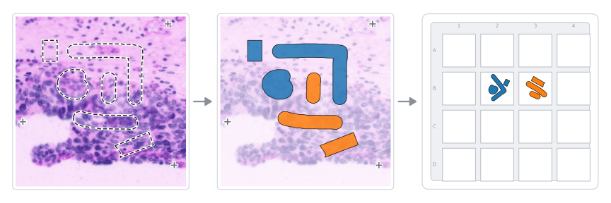
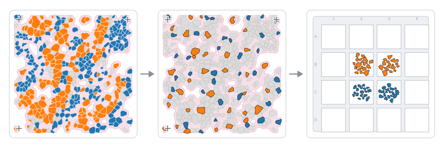
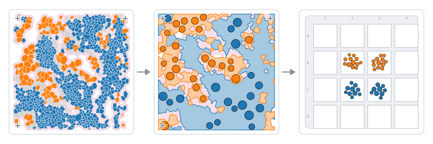
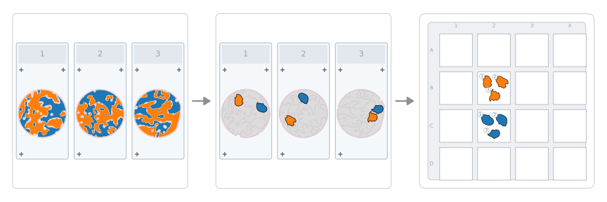
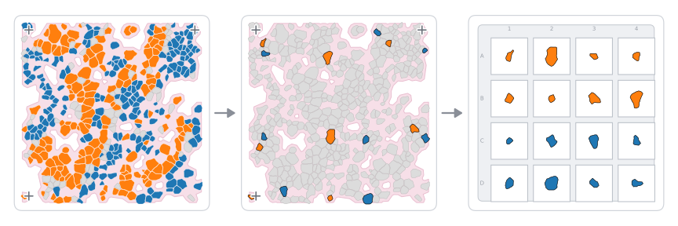
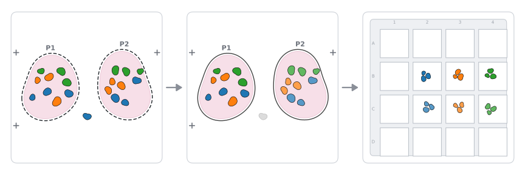

[](https://qupath-to-lmd-mdcberlin.streamlit.app/)

# [Streamlit Webapp Link](https://qupath-to-lmd.streamlit.app/)

# Introduction

QuPath-to-LMD is the easiest way to go from QuPath annotations to LMD collection!

Three ways to collect:
1. **Whole shapes**, the standard where every classified annotation is cut
2. **Selected shapes**, where you ask for a number of cells (or annotations) or an area per replicate and the app picks them
3. **Regions and circles**, where classified cells are turned into contiguous regions of tissue and small circles are packed inside them to collect a set amount of each.

## Vignettes

### Vignette 1: Manually annotated shapes



### Vignette 2: Collect segmented cells of different types



### Vignette 3: Create regions of cells from phenotyped, circle pack, and collect



### Vignette 4: Collect from multiple slides



### Vignette 5: Collect single cells form phenotyped tissue



### Vignette 6: Several patients on one image, kept apart by parent annotations



Annotate with the same few classes for every patient, draw one parent annotation around each
patient's tissue, and the app names the samples for you: `Gland` inside the `P1` parent annotation
becomes `P1_Gland`. Try it with `demo_Qupath_project/parent_annotations_two_patients.geojson` — see
[Several patients or regions on one image](#several-patients-or-regions-on-one-image).

## Streamlit webapp summary

The page has four stages, always in this order, and the sidebar keeps a one-line summary of your
experiment in view (e.g. *2 slides → 27 samples → 1 plate*):

1. **Slides** — upload one `.geojson` per slide (several at once, or a `.zip` of them), and choose
   each slide's calibration points
2. **Samples** — choose how to collect (whole shapes, selected shapes, or regions and circles) and
   how much
3. **Collector** — choose what to collect into: a 384 or 96 well plate, an Eppendorf tube holder
   (4 tubes, `A`–`D`) or an 8-well strip holder (one strip, `A`–`H`); more collectors appear when
   the samples need them, each one its own cutting run. One kind of collector per experiment.
4. **Cut** — process the files and download them

<a href="https://qupath-to-lmd-mdcberlin.streamlit.app/">
  
</a>

## How to annotate tissues in QuPath

### Option 1: Manually

1. Create a Qupath Project
2. Load images of interest
3. Draw annotations
4. Classify them using QuPath's class system
5. Add at least 3 calibration points using the point tool, and **name each one**
6. Export as a **FeatureCollection** in the **.geojson** format
7. Load into webapp

### Option 2: Classified segmented cells

1. Create a Qupath Project
2. Load images of interest
3. Cell detection (optimize segmentation here)
4. Classify them using [QuPath's tools](https://qupath.readthedocs.io/en/stable/docs/concepts/classifications.html):
    - For example: Classify -> Object -> Create single measurement classifier
5. Add at least 3 calibration points using the point tool, and **name each one**
6. Export as a **FeatureCollection** in the **.geojson** format
7. Load into webapp

### Several patients or regions on one image

Most experiments have one sample per image and can skip this. When one image holds tissue from
several patients (or cores, or regions you want kept apart), you do not need a QuPath class for
every patient × category combination. Use **parent annotations** instead:

1. Make one class per patient (`P1`, `P2`, …) and draw **one annotation around each patient's
   tissue** with it. This is the patient's parent annotation. A patient in two pieces can have two
   parent annotations of the same class.
2. Annotate the structures with your categories only (`Gland`, `Stroma`, …), the same for every
   patient.
3. In the app, at the top of **Samples**, switch on *Parent annotations* and tick `P1`, `P2`, …
   under *Classes of the parent annotations*.

Every annotation inside a parent then takes its name — `Gland` inside `P1` becomes `P1_Gland` —
and parent annotations themselves are never cut. With several slides, `P1_Gland` from every slide
goes into the same well, so a patient spread over several images pools together and patients never
mix. Replicates are set later, in the collection method, as usual.

A shape that sits in no parent annotation, or inside parent annotations of two different patients,
is **not collected**: the app says how many, per class, and draws them grey so you can fix the
parent annotation in QuPath. The demo file `demo_Qupath_project/parent_annotations_two_patients.geojson`
has two patients, three classes each, and one stray shape between them to show that warning.

## How to collect

### Whole shapes

Every classified annotation is cut, one class per well. Optionally split a
class into one shape per well for single-cell collection.

### Selected shapes

For files with thousands of classified cells, or annotations you want up to an amount. Choose your classes, then set replicates and how much goes into each, either as a number of cells or as µm². The app spreads the chosen cells across the tissue so a replicate is not one corner of the slide, can avoid cells touching another cell you are collecting, and shows you exactly which cells were picked before you export. Cells below a minimum area (100 µm² by default, per class) are left out, so keeping only the shapes you can actually collect.

You decide:

- How many replicates
- How much area or shapes per replicate

Both can be set once for every class with *Apply to every class* above the table, then changed
for single classes in the table.

### Regions and circles

Merge neighboring cells of the same class. Neighbor distance criteria is set by you. Then pack the areas with your sampling strategy. You can decide:

- How many replicates (once for every class, or per class)
- How much area per replicate (once for every class, or per class)
- Minimum circle size
- Maximum circle size

#### Worth knowing:

- Circles cut better than one enormous irregular outline, and they let you ask for a measured amount rather than all of it.
- A region covers the space *between* the cells as well, because that is the tissue belonging to that class, so it reaches past the outlines QuPath drew.
- Smoothing shaves a little area off every circle, so if that adds up to more than a few percent the app says so and tells you how to avoid it.

All three let you set the smoothing tolerance and the cutting order, and all download
the same bundle: the `.xml` for the LMD, the plate scheme, a QC image, your processed
`.geojson`, and a log.

# [Youtube Tutorial Playlist](https://www.youtube.com/playlist?list=PLUgFa3Qqznks)

## Qupath to LMD: Version 5 Release

[](https://youtu.be/vqGrv4z22-w)

## QuPath to LMD: Cellular neighborhood collection

[](https://youtu.be/epFm49fuIIo?si=Z_BqP8ZcASR4nkEF)

## QuPath to LMD: Segmentation-based collection

[](https://youtu.be/dlf01NiVI_U?si=UdddnBcltUNA2TPd)

# Contributing

```console
git clone https://github.com/CosciaLab/Qupath_to_LMD && cd Qupath_to_LMD
uv sync
uv run streamlit run streamlit_app.py
```

- Branch off `dev` and open the PR against `dev`.
- Before opening it: `uv run pytest`, `uv run ruff check src tests streamlit_app.py`, and
  `uv run python tools/golden_harness.py check`. The last one compares the exported `.xml` and
  `.csv` byte-for-byte against committed reference output — it is what catches a coordinate that
  moved by a pixel, which is invisible in the running app.
- Computation belongs in the library layer (`src/qupath_to_lmd/`, no Streamlit); anything that
  touches `st.*` belongs in a `ui_*` module.
- Adding a dependency means both `pyproject.toml` and
  `uv pip compile pyproject.toml -o requirements.txt` — the deployed app installs from
  `requirements.txt`.
- [`facts.md`](facts.md) records what is true about the app, [`decisions.md`](decisions.md) why it
  is that way, and [`GLOSSARY.md`](GLOSSARY.md) the vocabulary.

# Changelog

What changed in each release, in plain language: [CHANGELOG.md](CHANGELOG.md).

# Citation

Please cite the following work when using this package:

Please cite the [BioArxiv](https://www.biorxiv.org/content/10.1101/2025.07.13.662099v1):

Nimo, J., Fritzsche, S., Valdes, D. S., Trinh, M., Pentimalli, T., Schallenberg, S., Klauschen, F., Herse, F., Florian, S., Rajewsky, N., & Coscia, F. (2025). OpenDVP: An experimental and computational framework for community-empowered deep visual proteomics [Preprint]. bioRxiv. https://doi.org/10.1101/2025.07.13.662099

# FAQ

(0) What is the samples and well scheme?

It is the text, written in the format of a python dictionary, that allows the code to understand to which well will the countours be cut into. 

This is an example:

```python
{   
"Class_name_1" : "C3",  
"Class_name_2" : "C5",  
"Class_name_3" : "C7",  
}  
```

Each "Class_name_" is the exact name of the class of annotation found in Qupath.
The "C3", "C5", "C7" strings determine which well each class of shapes is collected into.
Works for 384-well and 96-well plates. For the tube holder and the strip holder the positions are letters only, e.g. `{'Tumor': 'A', 'Stroma': 'B'}`

(1) I have a KeyError type of error, what do I do?

KeyError is usually because your samples_and_wells does not match your geojson file.
Check them, they have to be exactly the same.

(2) Not sure if your .geojson file is the correct format?

Check the example_input folder in the repository to see how they should look like.

(3) I have an error what do I do?

Create a gihtub issue explaning what are you doing and pasting the Traceback (the code that is trying to tell you what went wrong)

(4) I have different number of replicates per category of samples?

Either you create a set of classes that includes unnecessary classes and remove the ones you don't need from the samples and wells, or you create a set of classes that includes most samples, and then add the samples that have more replicates.

(5) Can I somehow set a threshold of how much area to annotate per class?

In the cell segmentation workflow, yes: set the per-replicate amount in µm² and the app collects
up to it, telling you if a class cannot supply what you asked for. For annotations it is still
manual — sum the area per class in QuPath's measurements, or limit the collection in the LMD7
software (>8).

(6) What if I want to collect various slides of tissue into the same 384wp

Upload all the slides together — select several `.geojson` files, or upload a `.zip` of a folder of
them. Each slide keeps its own calibration points and gets its own `.xml`.

- **Into the same wells:** shapes of the same class on different slides are pooled into the same
  sample. That is right when the slides are sections of the same sample (e.g. serial sections),
  classified with the same classes. With an amount per replicate, you choose where it comes from:
  in proportion to what each slide holds, an equal share from each, or the slides in order.
- **Into different wells:** give each slide's classes different names in QuPath (e.g.
  `P1_Tumor`, `P2_Tumor`), and they become separate samples.

The download holds one `.xml` per slide (and per collector, in folders such as `Plate1/` or `TubeHolder2/`), a `samples.csv` saying what each well
gets from each slide, and `COLLECTION_PLAN.txt` with numbered steps for the LMD. To export every image
of a QuPath project at once, run `demo_Qupath_project/QuPath_scripts/export_for_lmd.groovy` with
*Run for project*, then zip the folder it writes.

You can still fill one plate over several sessions with **Start at well** in the collector settings.

To try it, `demo_Qupath_project/demo1/` holds six slides: two patients, three serial sections
each, with classes named per patient (`P1_Cancer`, `P2_Cancer`, …). Upload all six: each patient's
sections pool into the same wells, and the two patients stay apart.

(7) How should I position my calibration points?

The closer the three calibration points are to the annotations the less distortion you are going to suffer.
Your tolerance for distortion depends on the size of your annotations (single cells will suffer greatly, mini-bulk less so).

For example:


In this image the small shapes at the top will likely suffer distortion, so the collection would be of different tissue than the one annotated for.

The solution is to separate into two sets of shapes, each with its own closer calibration points:


